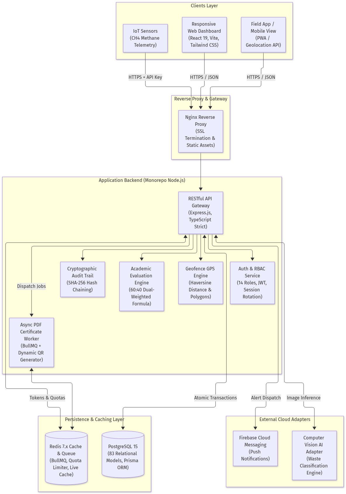

<p align="center">
  
</p>

<p align="center">
  <a href="https://jexydev.github.io/jexydev-3d-studio/"></a>
  <a href="mailto:Jeremyddarell@gmail.com"></a>
  
  
  
</p>

---

## Executive Engineering Summary

I am **Jeremy Darrell Andreas** (`JexyDev`) — a Fullstack Software Engineer, Distributed Systems Builder, and Hardware IoT Developer from Indonesia. 

> **Engineering Philosophy:** `Vibing Code > Vibe Code.`  
> I don't write disposable AI prompts, toy CRUD tutorials, or resume-driven abstractions. I engineer battle-tested software systems designed to survive real-world chaos: spotty cellular connectivity in rural districts, student GPS spoofing, concurrent database race conditions, and physical Modbus RS485 serial communication frames.

As a student developer at **SMK Wikrama Bogor** (PPLG) working with **PT. Makerindo Prima Solusi** and **Universitas Komputer Indonesia (UNIKOM)**, I stepped up to become the **#1 Top Contributor** on the enterprise municipal platform **BERSEKA (`berseka.id`)**, authoring **1,437 non-merge commits (45.5% of total team output)** and **2,016+ total commits** across an active 302,189-line TypeScript monorepo.

```
╔═══════════════════════════════════════════════════════════════════════════════════════╗
║                      THE CYNICAL-EMPATHIC CRITICAL THINKER                            ║
╠═══════════════════════════════════════════════════════════════════════════════════════╣
║  • Cynical Realism  : Assume network drops, malicious payloads, concurrency races,   ║
║                       and GPS mock locations are inevitable. Build defensive,         ║
║                       zero-trust, idempotent systems with strict transaction rollback.║
║  • Human Empathy    : Code is for real people under real pressure. In municipal apps, ║
║                       an unhandled 500 error strands field officers in the rain. In   ║
║                       IoT agriculture, dropped frames ruin crops. Resilient UX is    ║
║                       human empathy.                                                  ║
║  • Empirical Rigor  : Zero tolerance for AI slop or hand-waving architecture. Every   ║
║                       claim must be backed by compiler checks, test matrices, git     ║
║                       logs, and reproducible production telemetry.                    ║
╚═══════════════════════════════════════════════════════════════════════════════════════╝
```

---

## 🏛️ Flagship Production System: BERSEKA (`berseka.id`)

> **Municipal Smart Waste Governance & Academic Field-Service Lifecycle Platform**  
> **Collaborators:** PT. Makerindo Prima Solusi × Universitas Komputer Indonesia (UNIKOM)  
> **Operational Scope:** Coblong District, Bandung, West Java (Piloted across dozens of RWs, hundreds of KKN Tematik students, and municipal officers).  
> **Live Deployments:** [Production (berseka.id)](https://berseka.id) · [Staging (staging.berseka.id)](https://staging.berseka.id) · [Private Codebase (JexyDev/Pilah-Sampah-Cerdas)](https://github.com/JexyDev/Pilah-Sampah-Cerdas)

<p align="center">
  
  <br/>
  <sub><i>Figure 1: High-Level C4 Container Architecture of the BERSEKA Monorepo Ecosystem.</i></sub>
</p>

### 📊 Verified Forensic Engineering Metrics

| Architecture Metric | Verified Production Value | Technical Significance |
|:---|:---|:---|
| **Personal Git Output** | **1,437 non-merge commits (45.5% of team)** | **Top Contributor #1** in monorepo history (2,016+ commits total) |
| **Monorepo Commits** | **3,333 Main / 4,119 Total Commits** | 5-month sprint with **258 midnight commits** (18:00–06:00) & **159 weekend commits** |
| **Monorepo Code Volume** | **302,189 Lines of Code** | 563 source files (307 Express API, 256 React Web) with **0 TypeScript errors** |
| **Prisma Relational Models** | **83 Domain Models (951+ Columns)** | Cross-linked relational schema with foreign key cascades and spatial indices |
| **Documented REST APIs** | **659 Endpoints across 54 Route Controllers** | Strict payload validation, role-gating middleware, and unified error handler |
| **Client Views & UX** | **67 Discrete React Views** | 8-Tier RBAC (Super Admin, Camat/Lurah, DPL, Mahasiswa, RT/RW, Petugas, Warga) |
| **Async Queues & Workers** | **BullMQ + Redis 7** | Non-blocking background PDF generation, quota limiters, and cache invalidation |
| **Live VPS Environments** | **2 Ubuntu VPS Nodes** | Automated GitHub Actions CI/CD deploying to Staging & Production via PM2 Cluster |

---

### ⚡ 5 Hard Engineering Challenges & How I Solved Them

#### 1. Anti-Mock GPS Geofencing Defense for Field Attendance
* **The Problem:** University KKN students deployed across Coblong District occasionally used mock location software (Fake GPS) to spoof attendance at community posko points.
* **My Solution:**
  1. Implemented backend **Haversine Great-Circle Distance** verification with dynamic polygonal bounding boxes and a 15-meter buffer radius:
     $$\text{dist} = 2R \cdot \arcsin\left(\sqrt{\sin^2\left(\frac{\Delta \phi}{2}\right) + \cos(\phi_1)\cos(\phi_2)\sin^2\left(\frac{\Delta \lambda}{2}\right)}\right)$$
  2. Built multi-factor spoofing heuristics: detecting mock provider flags, client-vs-server timestamp drift, and impossible geographic velocity jumps.
  3. Created automated reconciliation scripts (`apps/api/scripts/verify-kelompok1-dago.ts`) that audit historical logs and purge fraudulent timestamps.

#### 2. Asynchronous Multi-Page E-Certificate PDF Generator with Public Dynamic QR
* **The Problem:** Generating hundreds of official 2-page completion certificates with academic transcripts on the main Node.js thread caused CPU event-loop blocking and memory exhaustion.
* **My Solution:**
  * Offloaded vector rendering to asynchronous **BullMQ** job workers backed by **Redis 7**.
  * Structured high-precision 2-page document compilation (Page 1: Official Municipal Diploma, Page 2: Full Posko Hours Transcript).
  * Implemented an unauthenticated public verification endpoint (`/verify/:certificateId`) allowing employers and municipal officers to scan the dynamic QR code and instantly verify document authenticity against cryptographic database hashes.

#### 3. Dual-Weighted Academic Evaluation Engine (60:40 Formula)
* **The Problem:** Discrepancies between daily field activity logs and final faculty reviews led to subjective and contested academic grades.
* **My Solution:**
  * Engineered an immutable grading pipeline:
    $$\text{FinalScore} = (0.60 \times \text{DailyActivityRatio}) + (0.40 \times \text{FacultyRubric})$$
  * Enforced strict state transitions: once a grade is locked to `FINAL`, database records become immutable to prevent retroactive grade tampering.

#### 4. Fault-Tolerant Streaming Ingest for Municipal Excel Datasets
* **The Problem:** Municipal demographic datasets containing thousands of household records arrived with messy formatting, irregular headers, and missing keys, crashing typical batch scripts.
* **My Solution:**
  * Built a chunked streaming XLSX parser validating row-by-row payloads against strict **Zod** schemas.
  * Wrapped all database operations in atomic `prisma.$transaction` blocks. If any row violates relational integrity, the transaction cleanly rolls back (0 orphaned records) and outputs an exact line-by-line error map.

#### 5. Cryptographic Tamper-Evident Audit Trail
* **The Problem:** Municipal compliance required that waste weight logs and student evaluation mutations be provably auditable without risk of retroactive database modification.
* **My Solution:**
  * Built an internal **SHA-256 Hash Chain** on all critical mutation records:
    $$\text{Hash}_n = \text{SHA256}(\text{Hash}_{n-1} + \text{Timestamp} + \text{ActorID} + \text{Payload})$$
  * Any direct database tampering breaks the hash chain, immediately raising verification alarms.

---

## 🌾 Hardware & Industrial IoT: Bitanic

> **Vocational Smart Precision Agriculture LMS & Industrial IoT Workstation (ATPH 4.0)**  
> **Repository:** [github.com/JexyDev/Bitanic](https://github.com/JexyDev/Bitanic) (Private)  
> **Hardware Target:** Fleet of laboratory IoT Trainer Kits (`BITANIC-TK-01` through `BITANIC-TK-06`)

```
┌─────────────────────────────────────────────────────────────────────────────────────────────┐
│ VERIFIED METRICS : 37 Eloquent Models │ 41 Migrations │ Modbus RS485 RTU │ 7-in-1 Soil Sensor│
│ 4 Relays Actuated: Zero-IDOR Tenancy  │ Collision-Free Lab Booking via Pessimistic Locking  │
└─────────────────────────────────────────────────────────────────────────────────────────────┘
```

- **Hardware Protocol:** Direct serial communication over **Modbus RS485 RTU** with strict **CRC16** checksum calculation and frame validation.
- **Sensor Telemetry:** Ingests 7-in-1 industrial soil chemistry frames: pH, Electrical Conductivity (EC), Moisture, Temperature, Nitrogen (N), Phosphorus (P), and Potassium (K).
- **Actuator Control:** Automated precision relay actuation (Irrigation Valve, Mist Generator, Nutrient Pump A, Nutrient Pump B).
- **Concurrency & Scheduling:** Solved physical hardware contention by implementing pessimistic database locking (`lockForUpdate`) on PostgreSQL 17, preventing double-booking of physical lab workstations.
- **Stack:** `Laravel 12` · `PHP 8.2+` · `PostgreSQL 17` · `Tailwind CSS v4` · `Vite` · `Docker`

---

## 📱 Mobile Commerce: Bogor Tolo

> **Hyperlocal SME Marketplace & Digital Storefront Ecosystem**  
> **Repositories:** [github.com/JexyDev/tolo_app](https://github.com/JexyDev/tolo_app) (Mobile) · [github.com/JexyDev/tolo-api](https://github.com/JexyDev/tolo-api) (Backend)

- **Architecture:** Cross-platform **Flutter** (iOS & Android) mobile application utilizing **Riverpod** state management, communicating with a decoupled **Laravel REST API** and administrative web dashboard.
- **Core Features:** Real-time product indexing, merchant digital storefronts, order tracking, and regional inventory synchronization for traditional merchants in Bogor, West Java.

---

## 🌐 Interactive 3D WebGL Systems Showcase

To visualize distributed micro-architectures, data conduits, and state machines in a visceral, spatial format, I engineered an interactive 3D WebGL studio:

<p align="center">
  <a href="https://jexydev.github.io/jexydev-3d-studio/" target="_blank">
    
  </a>
</p>

> **3D Studio Stack:** Vite · React 18 · TypeScript Strict · Three.js (`@react-three/fiber`, `@react-three/drei`) · Dynamic Camera Rig with frame-rate independent exponential easing · Articulated character models · Particle conduits · Deployed live on **[GitHub Pages](https://jexydev.github.io/jexydev-3d-studio/)**.

---

## 🛠️ Comprehensive Technical Skills Matrix

| Engineering Domain | Primary Technologies & Tooling | Production Proof & Implementation |
|:---|:---|:---|
| **Backend & APIs** | **Node.js, Express.js, TypeScript, Laravel 12, PHP 8.2+, REST APIs** | 659 endpoints in BERSEKA, 37 models in Bitanic, 54 route controllers, strict payload validation |
| **Databases & Cache** | **PostgreSQL (15/17), Prisma ORM, Eloquent, Redis 7, BullMQ** | 83 relational models, 951+ columns, pessimistic locking (`lockForUpdate`), atomic `$transaction` |
| **Frontend & Mobile** | **React 18/19, Vite, Flutter, Dart, Tailwind CSS, Leaflet GIS, Zustand** | 67 views in BERSEKA, cross-platform mobile apps in Bogor Tolo, geospatial boundary mapping |
| **Hardware & IoT** | **Modbus RS485 RTU, Serial Frames, CRC16 Checksums, Sensor Telemetry** | 7-in-1 soil chemistry sensor telemetry & 4 automated relay actuators in Bitanic |
| **DevOps & Infra** | **Docker, Docker Compose, Linux Ubuntu VPS, Nginx, GitHub Actions CI/CD** | 2 live production VPS nodes (`berseka.id`), PM2 cluster mode, SSL termination, automated CI pipelines |
| **Quality & Standards** | **Vitest, Jest, PHPUnit, Zod, ESLint, ISO/IEC 25010 Framework** | 73 automated test suites, zero TypeScript errors across 302K+ LoC monorepo |

---

## 📊 Real Engineering Telemetry & Activity

<!-- TELEMETRY:START -->
```
╔═══════════════════════════════════════════════════════════════════════════════════════╗
║                   JEXYDEV // SYSTEM TELEMETRY & WORKSPACE PULSE                       ║
╠═══════════════════════════════════════════════════════════════════════════════════════╣
║  Last Synchronized : 21 Nov 2026, 12:57:15 UTC │ 21 Nov 2026, 19:57:15 WIB            ║
║  Lifecycle Velocity: 3,700+ Production Commits Across Repositories (Full Performance) ║
║  Codebase Scale    : 302,189 LoC · 83 Prisma Models · 659 API Endpoints (berseka.id)  ║
║  Hardware Telemetry: Modbus RS485 RTU · CRC16 · 4 Relays Automated (Bitanic)          ║
║  Workspace Status  : ALL PRODUCTION REPOSITORIES SYNCHRONIZED & OPERATIONAL           ║
╚═══════════════════════════════════════════════════════════════════════════════════════╝
```
<!-- TELEMETRY:END -->

---

## 🤝 Professional Contact & Opportunities

I am actively open to **Software Engineering Roles (Fullstack / Backend / Mobile)**, mission-critical contract projects, and high-impact engineering teams.

<p align="center">
  <a href="mailto:Jeremyddarell@gmail.com">
    
  </a>
  <a href="https://github.com/JexyDev">
    
  </a>
  <a href="https://jexydev.github.io/jexydev-3d-studio/">
    
  </a>
  <a href="https://www.linkedin.com/in/jeremy-darrell-andreas/">
    
  </a>
</p>

<p align="center">
  <sub>© 2026 Jeremy Darrell Andreas (JexyDev) · SMK Wikrama Bogor · PT. Makerindo Prima Solusi · UNIKOM</sub>
</p>
