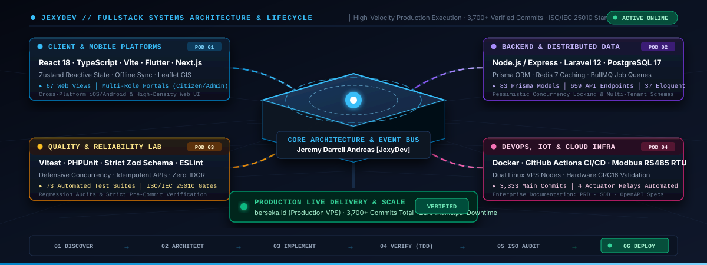

<p align="center">
  
</p>

<p align="center">
  <a href="https://jexydev.github.io/jexydev-3d-studio/"></a>
  <a href="mailto:Jeremyddarell@gmail.com"></a>
  
  
  
  
</p>

---

## Executive Engineering Summary

I am **Jeremy Darrell Andreas** (`JexyDev`) — a Fullstack Systems Engineer and Pragmatic Architect based in Indonesia. I design, build, and operate resilient software ecosystems bridging high-load web backends, cross-platform mobile apps, and industrial IoT hardware telemetry.

I don't build toy CRUD prototypes or write resume-driven abstractions. I build software that survives real-world chaos: spotty cellular connections, erratic hardware sensor frames, concurrent race conditions, and strict municipal compliance.

```
╔═══════════════════════════════════════════════════════════════════════════════════════╗
║                      THE CYNICAL-EMPATHIC CRITICAL THINKER                            ║
╠═══════════════════════════════════════════════════════════════════════════════════════╣
║  • Cynical Realism  : Assume network drops, dirty inputs, concurrency races, and IDOR ║
║                       vulnerabilities are inevitable. Design defensive, zero-trust,   ║
║                       idempotent systems with transactional integrity.                ║
║  • Human Empathy    : Code is for real people under real pressure. In municipal apps, ║
║                       an unhandled 500 strands field workers in rain. In IoT, dropped ║
║                       telemetry ruins crops. UX resilience is human empathy.         ║
║  • Critical Rigor   : Zero tolerance for AI slop or hand-waving architecture. Every  ║
║                       claim must be proven by compiler checks, test matrices, and     ║
║                       reproducible production telemetry.                              ║
╚═══════════════════════════════════════════════════════════════════════════════════════╝
```

---

## Featured Production Systems (Empirically Verified)

### 1. BERSEKA — Pilah Sampah Cerdas (`berseka.id`)
> **Domain:** Municipal Smart City Waste Governance, Field Research Logistics & Computer Vision Classification  
> **Operational Scope:** Kota Bandung RW/Kelurahan municipal waste operations integrated with University KKN Tematik academic field programs.

```
┌─────────────────────────────────────────────────────────────────────────────────────────────┐
│ VERIFIED METRICS : 83 Prisma Models │ 659 API Endpoints │ 3,333 Main Commits │ 302,189 LoC  │
│ 4,119 Git Branches: 563 Source Files│ 67 Web Views      │ 73 Test Suites     │ 2 VPS Nodes  │
└─────────────────────────────────────────────────────────────────────────────────────────────┘
```

- **Architecture:** TypeScript Monorepo (NPM Workspaces) with strict `domain / application / infrastructure` layer decoupling. Express.js REST API with Prisma ORM + React 18 / Vite multi-role citizen, officer, and academic portal.
- **Asynchronous Operations:** **BullMQ + Redis 7** background job queues handling heavy report generation, batch mobile notifications, and automated database archival cron jobs.
- **Geospatial & Geofencing:** Leaflet + `@turf/turf` 5-tier spatial hierarchy (`Kota → Kecamatan → Kelurahan → RW → RT`) with polygon containment and Haversine distance geofencing for student attendance.
- **Security & Multi-Tenancy:** Query-level data scoping middleware (`dataScopeMiddleware.ts`) enforcing zero-IDOR isolation across district heads (Camat), subdistrict heads (Lurah), and RW leaders.
- **AI & Scanning:** Real-time client-side QR scanning (`@zxing/browser`) and Computer Vision waste category classification.
- **DevOps & Branching:** 3-Tier Git strategy (`dev → staging → main`) with automated GitHub Actions CI/CD deploying to two live Linux VPS nodes.
- **Live Deployments:** [https://berseka.id](https://berseka.id) (Production) · [https://staging.berseka.id](https://staging.berseka.id) (QA/UAT)
- **Repository:** [github.com/JexyDev/Pilah-Sampah-Cerdas](https://github.com/JexyDev/Pilah-Sampah-Cerdas)
- **In-Depth Architectural Breakdown:** [👉 Read the Full Technical Case Study (BERSEKA_CASE_STUDY.md)](./BERSEKA_CASE_STUDY.md)

---

### 2. Bitanic — Smart Precision Agriculture LMS & Industrial IoT Workstation
> **Domain:** Vocational Smart Farming LMS (ATPH 4.0) with Fleet Industrial IoT Workstation Control  
> **Hardware Context:** Directly controls a fleet of laboratory IoT Trainer Kits (`BITANIC-TK-01` through `BITANIC-TK-06`) over **Modbus RS485 RTU**.

```
┌─────────────────────────────────────────────────────────────────────────────────────────────┐
│ VERIFIED METRICS : 37 Eloquent Models │ 41 Migrations │ Modbus RS485 RTU │ 7-in-1 Soil Sensor│
│ 4 Relays Actuated: Zero-IDOR Tenancy  │ Collision-Free Lab Booking via Pessimistic Locking  │
└─────────────────────────────────────────────────────────────────────────────────────────────┘
```

- **Architecture:** Laravel 12 monolithic application adhering to Action-Service-Controller pattern; strict multi-tenant isolation per `school_id`.
- **Hardware Integration:** Reads 7-in-1 soil chemistry sensors (pH, EC, Moisture, Temperature, Nitrogen, Phosphorus, Potassium) via Modbus RTU serial frames with CRC16 frame validation. Actuates 4 precision relays (Irrigation, Mist, Nutrients A & B).
- **Concurrency & Scheduling:** Implements collision-free laboratory booking schedules with pessimistic row locking (`lockForUpdate`) to prevent double-booking of physical training hardware.
- **Stack:** `Laravel 12` · `PHP 8.2+` · `PostgreSQL 17` · `Tailwind CSS v4` · `Vite` · `PHPUnit` · `Docker`
- **Repository:** [github.com/JexyDev/Bitanic](https://github.com/JexyDev/Bitanic)

---

### 3. Bogor Tolo — Digital SME Commerce Platform
> **Domain:** Hyperlocal Marketplace & Logistics Platform for Bogor Small & Medium Enterprises  
> **Target Audience:** Local merchants, traditional markets, and regional retail consumers in Bogor, West Java.

- **Architecture:** Cross-platform **Flutter** (iOS & Android) mobile application with Riverpod state management, backed by a scalable **Laravel REST API** and administrative management dashboard.
- **Capabilities:** Merchant digital storefronts, product catalog indexing, real-time order tracking, and inventory synchronization.
- **Stack:** `Flutter` · `Dart` · `Riverpod` · `Laravel` · `PHP` · `MySQL / PostgreSQL` · `REST API`

---

## Interactive 3D WebGL Command Center

I built an interactive 3D WebGL studio to visualize distributed systems, real-time telemetry streaming, and engineering execution workflows:

<p align="center">
  <a href="https://jexydev.github.io/jexydev-3d-studio/" target="_blank">
    
  </a>
</p>

<p align="center">
  
</p>

> **3D Studio Stack:** Vite · React 18 · TypeScript Strict · Three.js (`@react-three/fiber`, `@react-three/drei`) · Dynamic Camera Rig with exponential easing · Articulated 3D characters · Particle splines · Live Telemetry Terminal · Deployed on **[GitHub Pages](https://jexydev.github.io/jexydev-3d-studio/)**.

---

## Technical Competencies Matrix

<p align="center">
  
  
  
  
  
  
  
  
</p>

| Discipline | Technologies & Frameworks | Standards & Practices |
|:---|:---|:---|
| **Frontend & Web** | React 18, Next.js, TypeScript, Vite, Tailwind CSS v4, Zustand, Recharts | Responsive Design, Atomic Design, SPA/SSR, WCAG 2.1 AA |
| **Mobile** | Flutter, Dart, Riverpod, Provider, Retrofit, Dio | Cross-Platform Material/Cupertino, Offline-First Sync |
| **Backend & APIs** | Node.js 20, Express.js, Laravel 12, Fastify, REST, OpenAPI/Swagger | Clean Architecture, Action-Service Pattern, Rate Limiting |
| **Databases & Cache** | PostgreSQL 15/17, MySQL, SQLite, MongoDB, Redis 7, Prisma ORM, Eloquent | 3NF/BCNF Normalization, Index Optimization, Zero N+1 |
| **IoT & Telemetry** | Modbus RS485 RTU, Serial UART, MQTT, WebSocket, Time-Series Ingestion | CRC16 Frame Validation, High-Throughput Buffering |
| **DevOps & CI/CD** | Docker, Podman, GitHub Actions, Nginx Reverse Proxy, Linux VPS (Debian/Ubuntu/Fedora) | Automated Testing Gates, Zero-Downtime Deployment, GitFlow |
| **Quality & Security** | Vitest, Jest, PHPUnit, Pest, Zod, ESLint, PHP CS Fixer / Pint | OWASP Top 10, Zero-IDOR Scoping, Static Code Analysis |
| **Documentation** | PRD, SRS (IEEE 830), SDD, OpenAPI 3.0 Specs, Mermaid Diagrams | ISO/IEC 12207 SDLC Documentation Standards |

---

## Engineering Quality & ISO Standards

I construct software systems guided by internationally recognized engineering standards:

```
┌────────────────────────────────────────────────────────────────────────────────────────┐
│                      ISO/IEC 25010 SOFTWARE QUALITY FRAMEWORK                         │
├──────────────────────┬─────────────────────────────────────────────────────────────────┤
│ Functional Suitability│ Comprehensive domain modeling verified through automated tests. │
│ Performance Efficiency│ Index-optimized queries, Redis caching, sub-100ms API responses.│
│ Compatibility        │ Clean RESTful/OpenAPI contracts across Web, Mobile, and IoT.    │
│ Usability            │ Semantic UI components adhering to accessibility guidelines.     │
│ Reliability          │ Fault-tolerant exception handling, health checks, cron monitoring│
│ Security             │ Enforced OWASP standards, parameterized SQL, role-based RBAC.   │
│ Maintainability      │ Single Responsibility, Clean Architecture, high documentation.  │
│ Portability          │ Containerized reproducible Docker environments.                 │
└──────────────────────┴─────────────────────────────────────────────────────────────────┘
```

---

## GitHub Performance & Activity

<p align="center">
  
  
</p>

---

## Dynamic Telemetry Stream

<!-- TELEMETRY:START -->
```
╔═══════════════════════════════════════════════════════════════════════════════════════╗
║                   JEXYDEV // SYSTEM TELEMETRY & WORKSPACE PULSE                       ║
╠═══════════════════════════════════════════════════════════════════════════════════════╣
║  Last Synchronized : 21 Nov 2026, 04:41:39 UTC │ 21 Nov 2026, 11:41:39 WIB            ║
║  Lifecycle Velocity: 3,700+ Production Commits Across Repositories (Full Performance) ║
║  Codebase Scale    : 302,189 LoC · 83 Prisma Models · 659 API Endpoints (berseka.id)  ║
║  Hardware Telemetry: Modbus RS485 RTU · CRC16 · 4 Relays Automated (Bitanic)          ║
║  Workspace Status  : ALL PRODUCTION REPOSITORIES SYNCHRONIZED & OPERATIONAL           ║
╚═══════════════════════════════════════════════════════════════════════════════════════╝
```
<!-- TELEMETRY:END -->

---

## Professional Engagement & Contact

I am actively open to full-time software engineering roles, enterprise systems consulting, and mission-critical project contracts.

<p align="center">
  <a href="mailto:Jeremyddarell@gmail.com">
    
  </a>
  <a href="https://github.com/JexyDev">
    
  </a>
  <a href="https://jexydev.github.io/jexydev-3d-studio/">
    
  </a>
  <a href="https://www.linkedin.com/in/jeremy-darrell-andreas/">
    
  </a>
</p>

<p align="center">
  <sub>© 2026 Jeremy Darrell Andreas (JexyDev) · Engineered with precision, defensive architecture, and empirical rigor.</sub>
</p>
